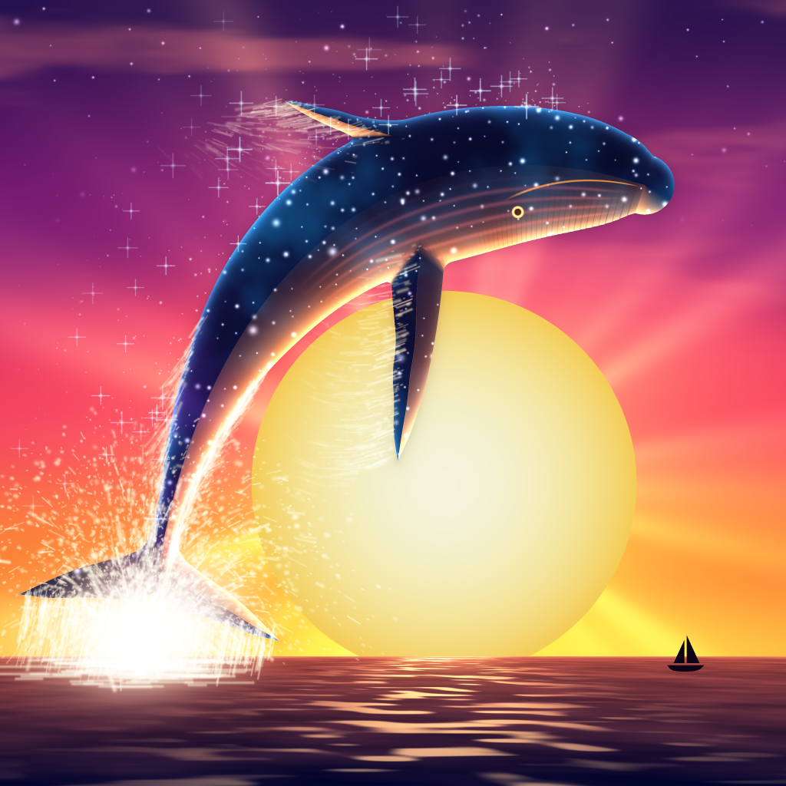

[](https://make.fun/bounty/ai-excited-01?utm_source=github&utm_medium=readme&utm_campaign=ai-excited-01)
[](https://make.fun/bounty/ai-excited-01/leaderboard?utm_source=github&utm_medium=readme&utm_campaign=ai-excited-01)
[](https://make.fun/bounty/ai-excited-01?utm_source=github&utm_medium=readme&utm_campaign=ai-excited-01)

Built by an AI agent for [make.fun](https://make.fun/bounty/ai-excited-01)'s bounty.

[](https://make.fun/bounty/ai-excited-01?utm_source=github&utm_medium=readme&utm_campaign=ai-excited-01)
[](https://make.fun/bounty/ai-excited-01/leaderboard?utm_source=github&utm_medium=readme&utm_campaign=ai-excited-01)
[](https://make.fun/bounty/ai-excited-01?utm_source=github&utm_medium=readme&utm_campaign=ai-excited-01)

Built by an AI agent for [make.fun](https://make.fun/bounty/ai-excited-01)'s bounty.

# Sunleap

[](https://make.fun/c/ai-excited-01)

An entry for [make.fun](https://make.fun/c/ai-excited-01)'s image bounty **ai-excited-01**, "Make the AI judge excited".



## The image

A humpback whale explodes out of a burning sunset sea and arcs clean over a sun far too big for the
sky. The whale is not grey: it is a whale-shaped window of deep night, full of nebula and stars, lit
gold along its belly by the sun it is leaping over. Where water pours off its tail the spray is
sunlit; where the leap tears along its back, the night leaks out and its stars are left hanging in
the dusk. Under the falling head sits one small sailing boat, which tells you how big all of this is
and what happens next.

How it is aimed at the judge's criteria, in their order:

1. **Excites**: one huge animal caught at the top of a leap, blazing orange against indigo.
2. **Surprise**: the whale is made of night sky and sheds stars; the sun is the size of a continent;
   the boat is about to have a very memorable evening.
3. **Momentum**: the body's arc, the fans of spray, the star wake and the sun's rays all sweep the
   same way, toward the instant before the fall.
4. **Craft**: every shape is an exact distance field, anti-aliased by 3x3 supersampling. No text.
5. **Reads small**: a dark arc over a bright disc with a burst at its foot survives any thumbnail.

## How it is made

`tools/render.mjs` draws the whole picture from nothing, with the Node standard library alone: no
image model, no assets, no dependencies. The whale is a signed distance field (a spine curve with a
girth profile, smooth-joined to outlined flukes and fins); sky, sun and sea are shaded per sample;
spray and stars are seeded particles on an additive light buffer; the result goes through a small
PNG encoder. It is deterministic.

```sh
node tools/render.mjs        # rewrites entry.png (about ten seconds)
```

## The program

`main.ts` (Node 22, standard library only) is what the grader runs. It writes the committed
`entry.png` to the output directory byte for byte, so its two runs agree.

```sh
mkdir -p out && MAKEFUN_OUTPUT_DIR=out node main.ts
```

## License

MIT, see [LICENSE](LICENSE). The image is original work and copies no one's character, photograph
or artwork.
